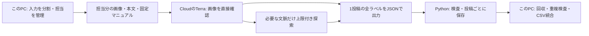

# Cloud構成：実装済み仕様への案内

現在の正本は `../docs/OPERATIONS.md` と `../docs/WORKER.md`。2026-11-11にCLI・自主予約キュー・416個の画像ZIPを実装した。以下は初期の選択肢比較として残す。統括による個別割当案は、担当が自分で原子的予約を取る方式に置き換えた。実Cloudでのモデル画像入力と認証は起動後のprobeで検証する。

# Codex Cloudで画像を直接分類する構成

更新日: 2026-11-11 JST / 設計案。Cloudでの画像表示・処理・結果回収の実機試験は未実施。

## 採用する方式

Cloud上のTerraが画像を直接読み、1投稿に必要な属性をまとめてJSONで出力する。Pythonは入力の準備、形式・整合性の検査、保存、再開、統合を担当する。利用するモデルはCodex側のTerraであり、この基本構成に別のLLM API呼び出しは含めない。

人手用アプリのボタン操作を作業単位にしない。投稿を読む・判定する・確定保存する、の3工程を繰り返す。既存アプリからは画像対応、質問と既存回答を参照する。新しい分類は別の版で保存する。



## Cloudの確認結果と未確認事項

| 項目 | 確認結果 | 設計への反映 |
|---|---|---|
| ファイル操作・コマンド実行 | 公式資料で確認 | Pythonを動かしJSON等のファイルへ保存できる。チャット本文に全結果を保持する必要はない |
| 環境の独立性 | 各タスクに独自の作業領域がある | 各担当に入力を明示して渡し、結果を明示して回収する |
| Computer Use | 現在のCloud制限に未対応と記載 | デスクトップ画面操作は必須条件にしない |
| ブラウザ | ブラウザアクセスを持つCloudタスクで利用可能と記載 | 一律に使えないとは言えない。通常分類では不要。外部調査の補助手段 |
| ローカルのファイル・ログイン状態 | 自動移送されない | WindowsのZIPパスをCloudに渡すだけでは読めない |
| ローカルの個人スキル | Cloudへ自動同期されない | 判定マニュアル、定義、補助コードを入力パッケージに同梱する |
| 画像をモデルに表示する手段 | Codexの公式ツール例にローカル画像を文脈へ添付するview_imageがある。ただしCLI向けの例で、特定Cloud環境への提供保証ではない | 最初の1環境で実際に画像内容を読めることを確認する。ファイルの存在確認だけで合格にしない |
| Terraの選択 | 現ホストの作成ツールは指定を受け付けるが、宛先環境での利用可否は作成時に検証される | Cloud側で実際のモデルを確認する。別モデルへの変更を黙って行わない |
| 現アカウントのCloud設定 | 起動可能な保存設定が4件ある。いずれも既存の別プロジェクトに紐づく | その事実だけで本研究用の画像・ネットワークが使えるとは判定しない |
| 利用枠 | ローカルとCloudで共有 | 並列数に応じて利用可能量が増えるとは見積もらない |
| ストレージ | 公式の標準構成に8GiBと32GiBのディスク区分がある | 約8.69GBの全ZIPを各担当へ配らず、小さい担当分を供給する |
| 保存状態 | 既定では最後の開始/再開から最大7日間復元可能と記載 | Cloud内の未回収ファイルを長期保管場所にしない |

以上は公式資料とツールの公開仕様を確認した結果。Cloud内での視覚能力・速度・通信・10〜20同時稼働はまだ測っていない。

出典（2026-11-11確認）:

- [Cloud environments](https://learn.chatgpt.com/docs/environments/cloud-environments)
- [Cloudでのブラウザ利用](https://learn.chatgpt.com/docs/browser#inspect-a-web-app-in-codex-cloud)
- [Codex environments](https://learn.chatgpt.com/docs/environments/modes)
- [公式のview_imageツール例（CLI向け）](https://developers.openai.com/api/docs/guides/latest-model?model=gpt-5.3-codex)
- [利用枠](https://learn.chatgpt.com/docs/pricing)

## 作業の大きさ

作業配分と画像を見る単位を分ける。

- 配布単位: まず25〜50投稿。投稿を分割して複数担当者に渡さない。
- 見る単位: 1投稿の全画像。今回のDBでは最大4画像。
- 出力単位: 1投稿の全項目を一つのJSONへまとめる。質問ごとに会話・保存しない。
- 確定単位: 1投稿。50投稿を最後にまとめて保存する方式は避け、途中停止による損失を1投稿内に抑える。
- 回収単位: 配布分の完了または中断時に、投稿別JSONをJSONLと完了一覧へまとめる。
- 会話の寿命: 最初は1チャット25〜50投稿を試験する。大量の画像履歴が蓄積する長いチャットにしない。再開はファイルを基準にする。

画像サイズの実測では、投稿あたり平均約0.402MiB、最大約12.451MiB、50投稿は平均約20.1MiB相当（元JPEGの合計、同一画像への参照を含む）。実際のパッケージサイズは選ばれた投稿群による。件数上限に加え、例えば64MiBのバイト上限を設ける。最終値は通信・画像読取の試験で調整する。

多数投稿を小さなコンタクトシート1枚へ縮める方法を、本判定の標準入力にはしない。小さい髪・顔・漫画内文字を潰さないよう、投稿内の原画像を順番とIDを付けて読む。

## 入力パッケージ

```text
batch_0001/
  manifest.json             # run、担当バッチ、投稿ID、画像対応、ハッシュ
  posts.jsonl               # 投稿ごとの本文、タグ、取得状態。人気指標は含めない
  schema.json               # 固定した回答の形と選択肢
  LABELING_MANUAL.md        # 判断基準・探索上限・unknownの扱い
  WORKER.md                 # このバッチの進め方
  worker_io.py              # next / commit / status / bundle
  images/<sha256>.jpg       # 担当分だけ。内容が同じ画像は一つ
```

既存の`attr.sqlite3`全体を各担当へ渡さない。人手回答と除外判断が含まれ、一次判定の独立性を損ねるため。`targets`と`tmedia`等から必要な入力だけを抽出する。

全ての投稿IDは文字列として扱う。Xの長いIDをJavaScriptの数値型へ変換しない。`media_index`は元DBの位置を維持する。

本文を取得する処理は画像分類より前に独立させ、取得時刻と失敗状態を保存する。本文取得が失敗しても、画像だけで判定できる項目は進める。既存のいいね・表示回数等は担当入力の許可項目に含めない。

## 担当者の操作

以下のCLIはこれから実装するインターフェース案であり、現在はコマンド本体を作成していない。

```text
python worker_io.py next
  -> 未完了の投稿ID、全画像のパス、本文、必要項目を表示

（Codexの画像表示ツールで実際の画像を読む）
（Terraがその投稿の全項目をまとめてdraft.jsonへ書く）

python worker_io.py commit --file draft.json
  -> スキーマ・ID・画像網羅・状態を検査し、投稿別ファイルへ原子的に確定

python worker_io.py status
  -> 完了、文脈保留、画像エラー、未着手の件数

python worker_io.py bundle
  -> labels.jsonl、review_queue.jsonl、receipt.json
```

モデルが考える部分は画像判定。PythonだけでCodexの視覚推論を自動ループ呼び出しできるという前提は置かない。ループを進めるのはCloudのCodexエージェントで、Pythonは入力と出力を確実に管理する。

検査が不合格なら、その投稿のJSONを直す。画像を未表示のまま、ファイル名や既存回答から値を生成しない。画像表示の記録は監査の補助であり、正しく見たことを機械的に保証するものではない。

## 出力の構造

投稿ごとの外枠に、その投稿の画像と各対象の属性を配列でまとめる。繰り返すIDやモデル情報は外枠へ置き、項目ごとの長い文章は避ける。既存マニュアルの1属性1行例は、保存後に生成できる長形式の例として扱う。

```json
{
  "run_id": "pilot-v2-001",
  "batch_id": "batch_0001",
  "post_id": "example-post",
  "schema_version": "2-draft",
  "manual_sha256": "example-manual-hash",
  "model_id": "gpt-6.1-terra",
  "stage": "visual_done_context_pending",
  "images": [
    {
      "media_index": 1,
      "sha256": "example-image-hash",
      "inspection_status": "viewed",
      "form": {"value": "illustration", "status": "observed"},
      "has_red_hair": {"value": true, "status": "observed"},
      "depictions": [
        {
          "id": "d1",
          "location": "左側の大きな人物",
          "body_form": {"value": "human_like", "status": "observed"},
          "hair_colors": {"value": ["red"], "status": "observed"}
        }
      ]
    }
  ],
  "creation": {"value": null, "status": "not_assessed", "reason_code": "context_pending"},
  "review_reasons": [],
  "evidence": [],
  "search_usage": {"queries": 0, "pages": 0, "elapsed_seconds": 0}
}
```

これは入出力形状を説明する抜粋で、全必須属性を埋めた完成レコードではない。`schema.json`は、見直した分類定義を固定する段階で作成する。モデル名は実際の実行モデルから設定し、例の文字列を無条件にコピーしない。

## 通常分類と外部探索を分離する

視覚属性は全件を同じ流れで処理する。一次/二次/公式等が本文から確定できれば同時に記録する。不明で探索が有用な場合だけ、投稿ID・画像の手掛かり・本文を文脈確認キューへ送る。

検索ツールを利用できる担当か、このPCの統括側が、既存マニュアルの上限内で調べる。通常担当が1投稿の調査で長時間停止しない構成にする。検索が使えない環境でも視覚分類を先に進められる。

`context_pending`はまだ調べていない状態、`unknown`は必要な確認を行った後の判定不能、`technical_failure`は取得等の失敗。統合時に混同しない。調査工程の担当を増やす数は、実測した発生率と滞留件数で決める。

## 入力配布と結果回収

Cloudの作業領域はローカルPCと共有されない。この経路は画像認識と同じくらい重要な成立条件である。

ユーザーの希望を踏まえ、GitHubへコード・分類定義・入力データ・結果を集約する案を第一候補にする。外部ストレージを別途用意することは必須ではない。GitHubにまとめることと、全バイナリを通常Gitの履歴に入れることは、分けて選べる。

### 通常Gitへ画像も入れる案

技術的には成立候補。実測した26,357画像の合計は8,674,685,019 bytes（約8.67GB / 8.08GiB）、最大ファイルは約4.84MiBであり、画像の中に100MiBを超えるものはない。

GitHubのrepository limitsは`.git`のサイズについて10GBの推奨最大値を示す。元ZIPが10GB未満であることを許可の保証と扱わない。同じGitHubのlarge files案内では1GB未満が理想、5GB未満を強く推奨とも記載されており、約8.67GBのバイナリは大きなリポジトリに当たる。Gitの圧縮結果と履歴の増分は投入時に測定する。

- ZIPを1ファイルのまま入れず、画像を展開して追加する。8GB超のZIPは通常Gitの1ファイル制限を超える。
- 1回のpushは2GB制限があるので、初回は余裕のあるサイズの追加コミットを作り、その都度pushする。分割コミットを全てまとめて1回pushする方法では転送量は減らない。
- 画像は固定入力として扱い、再圧縮した画像を何度も置き換えない。変更したバイナリの古い版は履歴に残る。
- 26,357ファイルを一つのフォルダに置かず、ハッシュ先頭2文字等で分ける。GitHubの推奨ディレクトリ幅は3,000。
- コード、マニュアル、画像対応表と画像を同じ入力コミットへ固定し、担当は結果ファイルだけを追加する。
- フルcloneではGit内部のデータと展開画像の両方が必要になる。8GiBのCloud構成には全画像自体が収まらない。32GiB構成でも作業中の追加コピーを含めて空き容量を測る。
- shallow cloneだけでは最新状態の全画像を省略できない。選択的取得にはpartial cloneとsparse checkout等が別途必要で、Cloudの自動checkoutがそれに対応しているとは仮定しない。

一度準備したCloud環境のファイル状態を再利用する案もある。これにより毎回の取得を減らせる可能性はあるが、環境の公開・リポジトリ更新・キャッシュの動作は最初の2担当で測る。全員が必ず8.67GBを再ダウンロードするとも、必ず共有キャッシュされるとも決めつけない。

### GitHub内のReleaseへ画像を置く案（配布効率を優先する案）

通常のリポジトリにコード・定義・入力マニフェスト・結果を置き、画像は同じ非公開リポジトリのReleaseへ担当分のZIPとして置く。GitHub内で管理を完結させつつ、担当は必要なZIPだけ取得する。

50投稿ずつなら約416パッケージ（バイト上限で追加分割する場合あり）。公式のRelease案内は1releaseあたり最大1,000assets、各ファイル2GiB未満、合計サイズ・配信帯域の上限なしと記載している。バッチの分割とSHA-256を入力マニフェストへ固定し、同名の入力を上書きしない。

画像はGitオブジェクトにはならず、Release添付となる。統括がバッチを一度アップロードし、Cloud担当が担当分をダウンロードする。結果は各担当専用のパスとブランチに保存して戻し、統括が検証して取り込む。共有CSVを複数担当が直接更新しない。

非公開Releaseの取得には認証とネットワーク到達性の確認が必要。リポジトリをcloneできる認証が、Release APIの読取にもそのまま使えるとは仮定しない。結果をリモートへ返す権限も合わせて実機確認する。ブラウザで手動ダウンロードする手順を本処理に組み込まない。

### Git LFSの位置付け

Git LFSで画像を管理する案も可能。ただしFree/Proでは公式にストレージ10GiBとダウンロード帯域10GiB/月の同梱枠があり、他の使用分も含まれる。今回の画像だけなら約8.08GiBで、保存量より繰り返し取得の帯域が問題になりやすい。

仮に20担当が全画像を一度ずつダウンロードすると約161.6GiB。これはキャッシュなしの仮定であり、実測消費ではない。LFSを使うなら自動の全取得を止め、必要なパスだけ取得する設定をcloneより前に適用できるか確認する。通常GitやReleaseの配布に、LFSの帯域枠をそのまま当てはめない。

### 接続と回収の確認

現時点ではリポジトリ作成・画像アップロード・Cloud環境の更新は行っていない。まず小さい試験用データで、Gitによる取得、画像表示、結果の保存・回収を通す。

GitHub側で配布が成立しない場合だけ、非公開ファイル保管場所のHTTPS受け渡しを代替にする。接続情報は環境の設定から渡し、長期認証情報をマニュアルや回答へ埋め込まない。

GitHubの一次資料（2026-11-11確認）:

- [Repository limits](https://docs.github.com/en/repositories/creating-and-managing-repositories/repository-limits)
- [About large files on GitHub](https://docs.github.com/en/repositories/working-with-files/managing-large-files/about-large-files-on-github)
- [About releases](https://docs.github.com/en/repositories/releasing-projects-on-github/about-releases)
- [Git LFS billing](https://docs.github.com/en/billing/concepts/product-billing/git-lfs)

このチャットから使えるCloud作成ツールの入力は、環境ID・プロンプト・モデル等。ローカルZIPをそのまま渡す添付引数や、ローカル/Cloud間の任意ファイル同期は、このツール仕様にはない。チャット作成だけで転送できたことにしない。

数件の動作確認なら、製品で利用できるファイル添付・ダウンロードを確認して手動受け渡しすることもできる。本処理は上記GitHubの取得・自動回収経路を実証してから拡大する。

Cloudから返すのは`labels.jsonl`、`review_queue.jsonl`、`receipt.json`。receiptには入力・出力ハッシュ、予定件数、処理済みID、残件、エラーを含める。チャット最終回答は件数と保存先の短い通知にする。統括側がファイルを取得し検証して初めて「回収完了」とする。

同じ実行キーの再送は同一内容なら受理済みとして扱い、異なる内容なら衝突として隔離する。成果を途中段階から回収できるようにし、処理済み画像を中断のたびに最初から見直さない。

## 統括と並列数

GitHubのバッチ別ブランチを進捗の正本にする。各担当が自分で未処理の仕事を予約し、完了後は次へ進む。統括の毎回の割当・承認は不要。停止時はleaseとcheckpointにより別担当が引き継ぐ。

最初はCloud1担当で成立条件を確認し、2担当で重複防止と回収を試す。その後5、10、必要なら20へ広げる。これは同時稼働が可能と保証した数字ではない。

主な遅さはモデル推論、画像を表示する回数、長い文脈、外部検索、ファイル転送、利用枠待ちになりうる。単にVMのCPUを増やしてもモデル推論が同じ比率で速くなるとは扱わない。

通常担当が全投稿の長い説明を返したり、同じマニュアルを毎投稿解説したりしないようにする。判断が難しい属性だけ短い根拠を付け、作業は一定の短いバッチで終える。判断基準は担当間で共通にする。

## 最初の実機確認

`cloud_capability_probe.md`を使い、1担当で次を確認する。

1. 選択したCloudでTerraを使える。
2. 配布した画像をモデルが実際に見られる。
3. 複数画像と投稿IDの対応を保ち、JSONを保存できる。
4. 検査で未処理画像や不正なラベルを検出できる。
5. 結果ファイルをこのPCへ回収でき、ハッシュと件数が一致する。
6. 中断後に保存済み結果から再開できる。
7. 本文取得・検索経路の可否が分かり、不可でも文脈保留として視覚工程を進められる。

画像をモデルへ表示する経路がない場合、この方式のCloud視覚担当は成立しない。同じ入力・JSON・検査の設計を維持し、画像ツールが使えるローカルCodexへ担当場所を変更する。別途の画像対応APIも代替案にはなるが、追加のAPI認証・課金・レート制限を伴うため自動的には切り替えない。

## 実装する最小セット

1. 入力作成: 旧DBから対象・画像対応を読み、担当分を作る`prepare_batches.py`。
2. 回答定義: `schema.json`と固定版の判定マニュアル。
3. 担当の入出力: `worker_io.py`のnext/commit/status/bundle。
4. 受け渡し: GitHubの取得・結果回収を担当する小さなモジュール。通常GitかReleaseかを選んでも分類処理の形式は変えない。
5. 統合: `collect_results.py`でマニフェスト・重複・欠落・版を検査し、SQLite/CSVへ統合。
6. 確認用: エラー・不一致・無作為監査分だけを人に見せる一覧。

Webサーバー、常設GUI、質問ごとの画面操作は、通常分類の実行条件に含めない。人が修正した履歴は別レコードとして保存する。

CLIと転送先は実装済み。最新の検証状況はdocs/READINESS.mdを参照。分類担当は起動前に報告するため、まだ起動していない。
